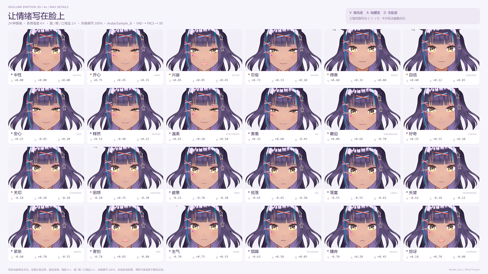

# Paper data and reproducibility materials

This is the **paper** research branch for *SoulLink: Capability-Aware Continuous Affective Animation for 2D and 3D Avatars*.

**[Open the anonymous study data and reproduction instructions](paper/README.md)** · [Response CSV](paper/data/perceptual_responses.csv) · [Stimulus pool](paper/data/stimulus_pool.csv) · [Reference results](paper/results/analysis.json)

The release contains 3,860 responses from 386 participants. The Python reproduction script checks the released data against the paper's reference statistics using 10,000 crossed participant–stimulus bootstrap draws. The application documentation below describes the pre-existing TypeScript application; the paper's optimization reference is a separate research implementation.

---

# Soullink Emotion 3D

在浏览器中把 VAD 情绪、FACS 动作单元和标准表情参数映射到 VRM 角色，实现连续、可调的 3D 面部表情。

**TypeScript · Three.js · three-vrm · Vite** · 本地手动控制无需训练或 AI 服务；可选 OpenRouter JEV 文本语义驱动。需要支持 WebGL 的浏览器。

**v0.5.1 表现修复**：主要眉眼嘴代理开放完整范围，减少高增益下的形变抵消，改善短时响应；新增明显展示预设、实际设置回读与浏览器参数保留。[表现与动作控制](docs/motion-control.md)。

**v0.5 角度控制**：新增九宫格转头、眼睛八向、头眼独立角度输入，校正 VRM 0.x 方向和眼球角度映射。[方向与角度控制](docs/direction-control.md)。

**v0.4 连续动作**：动作幅度与节奏随情绪变化，也可精确设置幅度、时长、速度和次数；AU、头部动作与视线连续衔接。[动作控制与接口](docs/motion-control.md)。

**v0.3 文本语义**：新增角色回应／按文本表演、连续 VAD 与影响强度、否定和引用处理、短动作及视线。[配置与接口说明](docs/semantic-jev.md)。

[演示](#演示) · [快速开始](#快速开始) · [功能](#功能) · [VRM 模型要求](#vrm-模型要求) · [文本语义](#文本语义) · [模型与授权](#公模与授权)



## 演示

[在哔哩哔哩观看最新演示视频](https://www.bilibili.com/video/BV1tqJy6sExV/)

仓库内也保留了一个可下载的演示版本：[MP4 视频](docs/media/QQ20261014-171445-HD.mp4)。

## 快速开始

需要 Node.js 20.19+ 或 22.12+。

```sh
npm ci
npm run dev
```

打开 http://localhost:4173/。Windows 也可以双击 `start-windows.bat`。

```sh
npm test
npm run build
npm run preview
```

构建输出位于 `dist/`，可部署到静态服务器。请通过 HTTP 服务访问，不要用 `file://` 打开 HTML。

## 文本语义（可选）

本地手动控制不需要 API Key。需要“角色回应 / 按文本表演”时，复制 `.env.example` 为 `.env.local`，填入本机服务使用的 `OPENROUTER_API_KEY`，然后重启开发服务：

```sh
Copy-Item .env.example .env.local   # Windows PowerShell
# cp .env.example .env.local        # macOS / Linux
npm run dev
```

Key 只由 Vite 本机服务端读取，不会打包进浏览器，也不要使用 `VITE_OPENROUTER_API_KEY`。纯静态部署仍支持情绪、AU、动作和方向控制，但不会包含 JEV 语义后端。详细配置见 [文本语义说明](docs/semantic-jev.md)。

## VRM 模型要求

**需要 VRM 角色模型才能显示和驱动面部。**可以使用内置公模，也可以在应用中导入自己的 `.vrm` 文件（支持 VRM 0.x 和 1.0）。普通图片、FBX 或 PMX 模型不能直接导入。

本仓库已包含四款公模，开发、测试和构建启动前仍会由 `scripts/fetch-models.mjs` 校验文件；缺少模型的轻量源码包会尝试下载并校验 SHA-256。GitHub 无法访问时，请使用含全部公模的完整压缩包。

## 功能

- 四款公模可切换；切换时保留情绪，并重新检测真实形变能力。
- 24 种状态（含中性）：开心、兴奋、忍俊、得意、自信、安心、释然、温柔、害羞、窘迫、好奇、关切、困惑、疲惫、低落、落寞、失望、紧张、害怕、生气、烦躁、嫌弃、惊讶、中性。
- 三维 VAD 空间同时显示 V / A / D，可旋转。V–A、V–D、A–D 投影可编辑两个坐标，同时保留第三轴。
- 连续 AU 映射、支配度规则、事件风格残留、眉眼嘴独立增益与平滑速率。
- ICT-FaceKit 官方 AU 对照基准；标准 FACS、ARKit 52 与 MediaPipe 结果适配。
- AU 锁定与释放、自然眨眼、低唤醒眼睑松弛、视线、头部姿态、点头、摇头、VRM 导入、实时曲线、JSON 导出与透明 PNG 截图。
- 文本语义驱动：可选接入 OpenRouter JEV，解析角色回应、表演模式、VAD、情绪强度、否定/引用、点头/摇头/眨眼、头部方向、眼睛方向及连续动作参数。
- 精确动作控制：支持幅度、时长、速度、重复次数、表情过渡和临时视线保持；动作会随当前情绪联动，也可切换为手动精确模式。
- 头部与视线控制：支持头部九宫格、眼睛八向、独立角度输入、侧倾和交回情绪目标；实际角度与模型骨骼能力可回读。
- 修复旧 VRM 的 targetNames 兼容：在加载内存中将 primitive extras 的名称交给 GLTFLoader，不修改原始 VRM。

## FACS 接入选择

采用 **ICT-FaceKit 官方公开的 AU → BlendShape 对照**作为适配基准，以 **Apple ARKit 52 通道**作为参数交换接口。

官方来源：
- https://github.com/USC-ICT/ICT-FaceKit#expression-shapes
- https://developer.apple.com/documentation/arkit/arfaceanchor/blendshapelocation/
- https://developers.google.com/edge/mediapipe/solutions/vision/face_landmarker/web_js

ICT 使用类似 ARKit 的命名，左右侧写为 _L / _R；适配器同时识别这些名称及 Left / Right。官方将 AU 与形变关系称为 closest relation，不是严格的一对一对应。Light 版本公开表格列出 53 个表达形变，不要混淆 Light 与 Full 模型的许可和功能。

本版接入官方对照与参数适配层，不包含 ICT 写实人头/PCA 资产，不执行神经自动绑定。保持二次元模型的已有拓扑、骨骼和风格化表情。模型缺失的鼻部或上唇形变必须通过建模补齐。

| 层 | 当前用途 |
| --- | --- |
| VAD / 情绪 | 连续混合、保持和衰减 |
| Soullink AU | 20 个 AU 通道及动作扩展 |
| FACS / ARKit 适配 | 标准参数输入输出、外部输入接管 |
| 模型适配 | 真正存在的直接形变或 VRoid 代理 |

例如 AU01 对应 browInnerUp，AU12 对应 mouthSmile，AU09 对应 noseSneer。ICT 的 AU10 对照为 mouthShrugUpper，而 mouthUpperUp 对应其表格中的 AU11。

AU23 / 25 / 26 桥接明确为近似：AU23 混入 mouthPress，AU25 / 26 与 AU27 合成 jawOpen。ARKit 不能独立表达全部 FACS，也不能从 ARKit 权重唯一反推 AU。

Apple ARKit 52 包含 tongueOut；MediaPipe 的 52 分类包含 _neutral，未提供 Apple tongueOut。因此适配时忽略 _neutral，未提供的 tongueOut 保持零。

左右按角色的解剖学左右定义。外部输入保留独立左右眼眨眼；VRoid 的 Close_L / Close_R 可驱动单眼。其他不对称动作能否表现取决于模型的分侧形变。

## 三维 VAD 与表情细节

全部轴使用 Soullink 的 [-1,1]：V=Valence 愉悦度，A=Arousal 唤醒度，D=Dominance 支配度；这里的 VAD 不是语音活动检测。

旧版只显示 V–A 平面。现在 D 改变会影响三维点位，也能在 V–D / A–D 投影中编辑。

固定 V=-0.65、A=0.7，再改变 D：

| D | 动画倾向 | 更突出的 AU |
| --- | --- | --- |
| +0.7 | 强势不满 / 生气 | AU04 眉毛下压、AU07 收眼、AU23/24 嘴唇张力 |
| -0.7 | 退缩 / 害怕 | AU01/02 提眉、AU05 睁眼、AU20 嘴唇拉伸 |

积极情绪中，高 D 强调得意、自信的收眼与微抬头；低 D 强调害羞、窘迫的回避视线与低头。这是作者制定的动画表达规则，不是心理诊断或普遍的情绪测量结论。

24 个 VAD/AU 锚点按加权三维距离平滑混合，带宽 0.24，不按最近标签硬切表情。事件具有单独的风格残留，区分 VAD 相近而表现不同的情绪，并随情绪衰减；手动设置 VAD 会释放该残留。

风格细节占比混合基础规则与锚点风格。眉、眼、嘴增益分别校准该区域。界面百分比是动画插值权重，不是识别概率；显示前三项，其他权重仍参与计算。

## 与 Soullink SDK 的关系

复用 https://github.com/nanlingyin/soullink-emotion-sdk 提交 02cd75ac0a085a87d84d1a885f1b33eca8742d53 的 20 个原始 TypeScript 文件；清单位于 vendor/soullink/SOURCE.json，原始文件未修改。

主要复用 EmotionStateController、VADExpressionMapper 连续基础部分、ActionUnitSolver、AU 定义、FACS 工具、情绪预设和时间平滑。该提交采用 Apache-2.0，完整许可保存在 vendor/soullink/LICENSE。本项目新增详细映射、标准适配和 3D 层，没有修改你的 GitHub 仓库。

情绪脉冲沿用 clamp(0.28 + intensity × 0.58, 0, 0.96) 目标混合，零强度由应用层跳过。保持 6 + intensity × hold 秒；直接设置 VAD 保持 4 + hold 秒。重复脉冲混合目标并延长保持。

目标到基线的距离按 exp(-decayRate × t) 回落，decayRate=ln(2)/halfLife。当前状态按 1-exp(-approachRate × dt) 追赶目标，因此面部稍滞后。引擎以 120 Hz 积分，避免渲染帧率改变保持边界。

演示默认半衰期 8 秒、表现增益 1.4、细节占比 65%；眉、眼、嘴平滑速度分别为 6.5、11、8 s⁻¹。这些不是 SDK 原始默认值。

## 公模与授权

| 模型 | VRM | Morph 数 | AU 代理覆盖 | 授权 |
| --- | --- | --- | --- | --- |
| AvatarSample_B | 1.0 | 57 | 17/20 | VRoid 官方样例条款 |
| AvatarSample_A | 0.x | 56 | 16/20 | VRoid 官方样例条款 |
| AvatarSample_C | 0.x | 54 | 17/20 | VRoid 官方样例条款 |
| Sendagaya Shino | 0.x | 41 | 16/20 | 官方 CC0 |

B 来自 pixiv 官方归档 ChatVRM；其他模型从 madjin/vrm-samples 镜像取得，并核对官方条款。各文件的 URL、原始元数据、大小、SHA-256 与许可链接保存在 public/models/catalog.json 和 SOURCE 文件中，原始字节未改动。

A/B/C 不是 CC0，不属于代码的 Apache-2.0 许可，应按官方样例条款使用。Shino 的 CC0 由其官方帮助页确认。

- https://vroid.pixiv.help/hc/en-us/articles/4402394424089
- https://vroid.pixiv.help/hc/en-us/articles/360013482714-Sendagaya-Shino
- https://vrm.dev/licenses/1.0/

57 个 Morph 不等于 57 个 FACS 或 ARKit 通道。当前四款公模均主要使用风格化代理，没有完整直接 ARKit 52 命名形变。缺失的鼻部、上唇、下巴通道明确禁用；需要严格逐肌肉表达时，应补建形变或导入对应绑定模型。blush / tear / sweat 未伪造 3D 材质效果。

## API

```js
window.soullinkFace.triggerEmotion('proud', 0.9);
window.soullinkFace.setVAD({ valence: -0.65, arousal: 0.7, dominance: -0.7 });
window.soullinkFace.setAU('au12LipCornerPuller', 0.7);
window.soullinkFace.setAU('au12LipCornerPuller', null);
window.soullinkFace.setFACS({ AU01: 0.3, AU12L: 0.7, AU45R: 0.8 });
window.soullinkFace.setBlendshapes({ eyeBlinkLeft: 0.8, eyeBlinkRight: 0.1 });
window.soullinkFace.setMediaPipeResult(faceLandmarkerResult);
window.soullinkFace.setBlendshapes(null);
window.soullinkFace.loadModel('AvatarSample_C');
window.soullinkFace.getBlendshapes();
```

外部信号视为完整帧，未提供通道归零。手动 AU 覆盖它拥有的通道。释放全部清除锁定与外部输入；新的情绪/VAD 指令也释放外部输入。切换模型释放覆盖、保留情绪。

模型映射页可导入 JSON：

```json
{"protocol":"facs","aus":{"AU01":0.3,"AU12":0.6,"AU45R":0.8}}
```

```json
{"protocol":"arkit52","blendshapes":{"browInnerUp":0.3,"mouthSmileLeft":0.6}}
```

标准 FACS 输入归一化到 0–1；OpenFace 0–5 强度应先除以 5，不会自动猜测尺度。未知 AU 编号被拒绝。ARKit 输入检查名称和有限值并限幅到 0–1。

MediaPipe 适配读取 faceBlendshapes[0].categories。本版提供结果适配，不自动打开摄像头或运行 Face Landmarker；可从你自己的上游将结果传入。

可独立使用 FaceEngine、DetailedVADMapper、facsToARKit 与 ausToARKit。AI Planner 输出情绪、VAD 或 AU 即可接入；密钥由自己的服务端管理。

## 源码与验证

| 文件 | 职责 |
| --- | --- |
| src/engine.ts | 时序、衰减、覆盖、信号所有权 |
| src/emotions.ts | 24 个表情锚点 |
| src/detailed-vad.ts | 三轴连续映射与细节 |
| src/arkit.ts | ICT 对照与标准协议 |
| src/space.ts | 三维空间与可编辑投影 |
| src/profile.ts | 模型映射与预算 |
| src/model-utils.ts | 旧 VRM 名称兼容 |
| src/viewer.ts | VRM、骨骼、直接/代理形变与释放 |
| scripts/fetch-models.mjs | 缺失模型下载与校验 |
| server/jev.ts | JEV 请求、结构化结果校验与 VAD/动作转换 |
| src/motion.ts / src/directions.ts | 连续动作、头部和视线目标 |

验证包括类型检查、生产构建、衰减、帧率一致性、VAD 连续性、D 的独立影响、所有情绪、参数协议、单侧权重、覆盖释放、动作/方向连续性、语义结果校验与文件校验。真实 Three.js/VRM 测试加载四款模型，并检查每个支持目标的非零几何形变。

```sh
npm test
npm run build
```

配置 `.env.local` 后，还可以运行 `npm run test:semantic:live`、`npm run test:motion:live` 和 `npm run test:directions:live`，对 JEV 发起真实请求；这些命令可能产生 API 费用，是功能验收，不是情绪识别准确率或心理测量结果。

Node 的 VRM 测试替代纹理解码，仅检查结构、几何和骨骼生命周期。当前环境未提供受支持的浏览器 QA，未宣称完成像素/视觉验收；首次打开目标设备后应检查显示与幅度。
